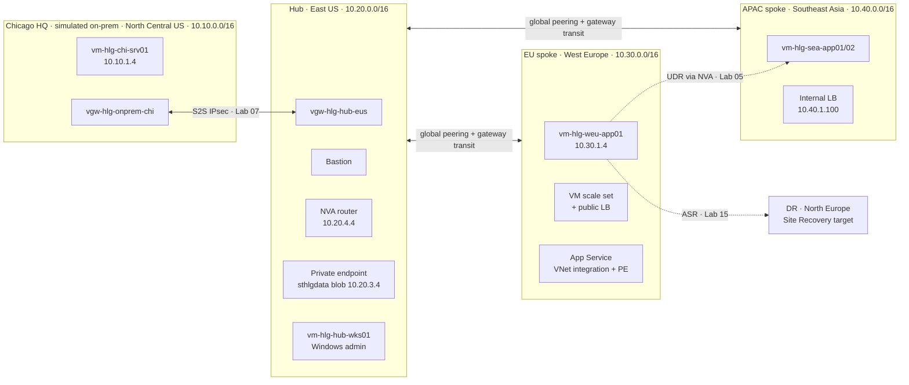

# Azure Hybrid Cloud Lab: AZ-104 Portfolio

I'm building, securing, breaking and fixing a multi-region hybrid Azure
environment in my own subscription, for a fictional freight company called
Halsted Logistics, while preparing for the AZ-104 (Azure Administrator) exam.

> **This is a personal lab project, not production work for an employer.**
> A lab is marked **Complete** only when my notes and redacted screenshots are
> committed, so every claim here can be checked.

## Progress

| Lab | Topic | Status | My write-up |
|---|---|---|---|
| 00 | [Setup, Tooling and a Cost Safety Net](labs/00-setup-and-safety-net.md) | Not started | [notes](notes/lab-00.md) |
| 01 | [Halsted Staff Identities, Licensing, Guests, SSPR and Conditional Access](labs/01-identities-and-conditional-access.md) | Not started | [notes](notes/lab-01.md) |
| 02 | [Governance: Management Groups, Policy, Tags, Locks and Costs](labs/02-governance-policy-locks-costs.md) | Not started | [notes](notes/lab-02.md) |
| 03 | [Infrastructure as Code: Deploy the Hybrid Foundation with Bicep and ARM](labs/03-iac-bicep-arm-foundation.md) | Not started | [notes](notes/lab-03.md) |
| 04 | [Role-Based Access Control Across Scopes](labs/04-rbac-access-control.md) | Not started | [notes](notes/lab-04.md) |
| 05 | [Virtual Networks, Peering, Public IPs, User-Defined Routes and Troubleshooting](labs/05-vnets-peering-routing.md) | Not started | [notes](notes/lab-05.md) |
| 06 | [Secure Access: NSGs, ASGs, Bastion, Service Endpoints and Private Endpoints](labs/06-secure-access-nsg-bastion-endpoints.md) | Not started | [notes](notes/lab-06.md) |
| 07 | [Hybrid Connectivity: Chicago HQ to Azure over Site-to-Site VPN](labs/07-hybrid-site-to-site-vpn.md) | Not started | [notes](notes/lab-07.md) |
| 08 | [Virtual Machines: Create, Encrypt, Resize, Disks, Availability and Moves](labs/08-virtual-machines.md) | Not started | [notes](notes/lab-08.md) |
| 09 | [Scale Sets, Load Balancers and Azure DNS](labs/09-scale-sets-load-balancing-dns.md) | Not started | [notes](notes/lab-09.md) |
| 10 | [Storage Accounts: Redundancy, Encryption, Keys, SAS, Firewalls and Identity-Based Azure Files](labs/10-storage-accounts-security-access.md) | Not started | [notes](notes/lab-10.md) |
| 11 | [Blob and Files Data Management: Tiers, Versioning, Soft Delete, Lifecycle, Replication, AzCopy](labs/11-blob-and-files-data-management.md) | Not started | [notes](notes/lab-11.md) |
| 12 | [Containers: Azure Container Registry, Container Instances and Container Apps](labs/12-containers-acr-aci-container-apps.md) | Not started | [notes](notes/lab-12.md) |
| 13 | [Azure App Service: Plans, Scaling, Slots, Networking, TLS, Custom Domains and Backup](labs/13-app-service.md) | Not started | [notes](notes/lab-13.md) |
| 14 | [Monitor and Maintain: Metrics, Logs, KQL, Alerts, Insights and Connection Monitor](labs/14-monitoring-alerts-network-watcher.md) | Not started | [notes](notes/lab-14.md) |
| 15 | [Backup and Disaster Recovery: Recovery Services Vault, Backup Vault and Site Recovery](labs/15-backup-and-site-recovery.md) | Not started | [notes](notes/lab-15.md) |
| 16 | [Capstone: Break-Fix Tickets, Exam Readiness, Teardown and Portfolio](labs/16-capstone-break-fix-and-teardown.md) | Not started | [notes](notes/lab-16.md) |

## Results

| | |
|---|---|
| Labs completed | 0 / 17 |
| Total Azure spend | - |
| Capstone incidents diagnosed without the answer key | - / 8 |
| AZ-104 result | Exam planned for December 2026 |
| Biggest lessons | Filled in as I go |

## How to review this work

- **notes/lab-NN.md**: what I built in my own words, the evidence table, what broke and how I fixed it
- **screenshots/lab-NN/**: redacted evidence for each checkpoint
- **iac/, policy/, rbac/, kql/, scripts/**: the code I deployed and ran
- No subscription IDs, tenant IDs, keys, SAS tokens or passwords are committed. A pre-commit secret scan blocks them, and every image is checked by hand ([docs/screenshot-guide.md](docs/screenshot-guide.md)).

---


**A hands-on AZ-104 (Microsoft Azure Administrator) lab series built around one realistic scenario:** a simulated Chicago datacenter connected to an East US hub, with spokes in West Europe and Southeast Asia. Seventeen labs cover **all 82 skills** in Microsoft's study guide (*skills measured as of 17 April 2026*), with exam tips placed in the steps where each concept appears, screenshot checkpoints for your portfolio, and a break-fix capstone.

> *Halsted Logistics Group (HLG) is a fictional company. This project isn't affiliated with or endorsed by Microsoft. Azure changes often, so verify details against Microsoft Learn and check prices in the Azure Pricing Calculator.*

---

## Architecture



Identity and governance wrap the whole thing: 10 Entra ID staff + a B2B partner, dynamic groups, Conditional Access, management groups, Azure Policy, RBAC at four scopes, budgets.

---

## The lab series

The order follows dependencies (governance before infrastructure, network before workloads), not the order of the study guide. [`docs/skills-coverage.md`](docs/skills-coverage.md) maps every official skill to its lab and task.

| # | Lab | Exam domain(s) | Time | Approx. cost* |
|---|---|---|---|---|
| 00 | [Setup, tooling and a cost safety net](labs/00-setup-and-safety-net.md) | Governance | 1.5 h | $0 |
| 01 | [Staff identities, licensing, guests, SSPR, Conditional Access](labs/01-identities-and-conditional-access.md) | Identity | 3 h | $0 |
| 02 | [Management groups, Policy, tags, locks, costs](labs/02-governance-policy-locks-costs.md) | Governance | 3 h | < $0.50 |
| 03 | [IaC: deploy the 4-region foundation with Bicep and ARM](labs/03-iac-bicep-arm-foundation.md) | Compute (IaC), Networking | 3 h | ~$1/day of VMs |
| 04 | [RBAC across scopes](labs/04-rbac-access-control.md) | Identity | 2.5 h | $0 |
| 05 | [VNets, peering, public IPs, UDRs, troubleshooting](labs/05-vnets-peering-routing.md) | Networking | 3 h | ~$0.10 |
| 06 | [NSGs, ASGs, Bastion, service and private endpoints](labs/06-secure-access-nsg-bastion-endpoints.md) | Networking | 3 h | ~$0.60 |
| 07 | [Hybrid: Chicago ↔ Azure site-to-site VPN](labs/07-hybrid-site-to-site-vpn.md) | Networking | 2.5 h | ~$1–2 (same-day delete) |
| 08 | [Virtual machines](labs/08-virtual-machines.md) | Compute | 3 h | ~$0.50 |
| 09 | [Scale sets, load balancers, Azure DNS](labs/09-scale-sets-load-balancing-dns.md) | Compute, Networking | 3.5 h | ~$0.80 |
| 10 | [Storage accounts: redundancy, CMK, keys, SAS, firewall, Azure Files identity](labs/10-storage-accounts-security-access.md) | Storage | 3.5 h | < $0.50 |
| 11 | [Blob and Files data management, Storage Explorer, AzCopy](labs/11-blob-and-files-data-management.md) | Storage | 3 h | < $0.30 |
| 12 | [Containers: ACR, ACI, Container Apps](labs/12-containers-acr-aci-container-apps.md) | Compute | 2.5 h | ~$0.50 |
| 13 | [App Service](labs/13-app-service.md) | Compute | 3.5 h | ~$0.50 |
| 14 | [Monitoring, KQL, alerts, Insights, Connection monitor](labs/14-monitoring-alerts-network-watcher.md) | Monitor | 3.5 h | ~$0.50–1 |
| 15 | [Backup, Backup vault, Site Recovery](labs/15-backup-and-site-recovery.md) | Monitor (backup/DR) | 4 h | ~$1–2 |
| 16 | [Capstone: 8 break-fix tickets, readiness gates, teardown](labs/16-capstone-break-fix-and-teardown.md) | All | 4 h | — |

\* If you follow each lab's clean-up the same day. See [`docs/cost-guide.md`](docs/cost-guide.md). **Budget about $40–80 for the whole series**, mostly VPN gateways, Bastion and App Service hours.

### Study tools
- 🎯 [`docs/exam-tips-cram-sheet.md`](docs/exam-tips-cram-sheet.md): every exam tip and trap from every lab on one page (generated)
- 🗺️ [`docs/skills-coverage.md`](docs/skills-coverage.md): 82/82 skills → lab and task
- 📋 [`docs/az104-skills-measured-2026-04-17.md`](docs/az104-skills-measured-2026-04-17.md): the official outline this series is checked against
- 📸 [`docs/screenshot-guide.md`](docs/screenshot-guide.md): naming, redaction, tools
- 💼 [`docs/portfolio-playbook.md`](docs/portfolio-playbook.md): how to present this to employers

---

## How every lab is built

- **Scenario**: the HLG business reason for the work
- **Skills measured covered**: the exact study-guide wording, so you always know what's being tested
- **Tasks**: *why it matters*, then portal steps (the exam's language), then CLI/PowerShell equivalents
- **Callouts placed in the steps where they apply:**

  | Callout | Meaning |
  |---|---|
  | `🎯 EXAM TIP` | A fact or comparison the exam tests |
  | `⚠️ EXAM TRAP` | A common distractor or wrong-answer pattern |
  | `💲 COST` | Something that bills. Delete it when told. |
  | `🧭 BEYOND THE OUTLINE` | In the scenario but not in the April 2026 skills list |
  | `🔒 DON'T POST THIS` | Secrets and identifiers to keep out of Git and screenshots |

- **📸 Checkpoints**: numbered screenshots (`screenshots/lab-NN/NN-MM-name.png`) that become your evidence
- **Break-fix challenges**, a **5-question knowledge check** with answers, **clean up**, and a **GitHub commit + LinkedIn post template**

---

## Quick start

1. Read [Lab 00](labs/00-setup-and-safety-net.md). It sets up the admin account, Entra ID P2 trial, Cloud Shell, budget and this repo.
2. Before each lab: `bash scripts/preflight.sh` (first time) and `bash scripts/start-all-vms.sh`.
3. After each lab: `bash scripts/cost-check.sh` and `bash scripts/stop-all-vms.sh`.
4. Copy [`notes/TEMPLATE.md`](notes/TEMPLATE.md) to `notes/lab-NN.md` and take notes as you go.
5. Before every push: `bash scripts/secret-scan.sh` (or install the hook once with `bash scripts/install-hooks.sh`).

## Repository layout

```
labs/                    00–16 lab guides
iac/bicep/               main.bicep (foundation) · workloads.bicep (VMs) · bastion.bicep · hybrid-vpn.bicep
iac/bicep/modules/       vnet · peering · linux-vm · vpn-gateway · vpn-site-link
iac/bicep/cloudinit/     web.yaml (no-internet web page) · nva.yaml (IP forwarding)
iac/arm/                 storage-account.json (Lab 03 starter) + .solution.json · sandbox-nsg.json
identity/                staff CSVs · New-HlgStaff.ps1 / Remove-HlgStaff.ps1 (Microsoft Graph)
policy/                  custom policy definition · deploy-hlg-policies.sh
rbac/                    custom role (HLG VM Operator) · interpretation exercise · assign-hlg-roles.sh
storage/                 lifecycle-policy.json
kql/                     hlg-queries.kql (12 queries for Lab 14/15)
apps/tracker-web/        Node.js app for App Service slots + VNet integration tests
scripts/                 preflight · cost-check · start/stop VMs · teardown · capstone-break
                         secret-scan · install-hooks · package-app · build-cram-sheet · check-coverage
docs/                    coverage matrix · cram sheet · cost / screenshot / portfolio guides
notes/  screenshots/     yours to fill
```

**Validation:** all Bicep files compile and lint clean (`az bicep build`), the ARM templates are valid JSON and decompile, and `python3 scripts/check-coverage.py` confirms 82/82 skills, no broken links and unique checkpoint IDs.

---

---

## License

[MIT](LICENSE)
