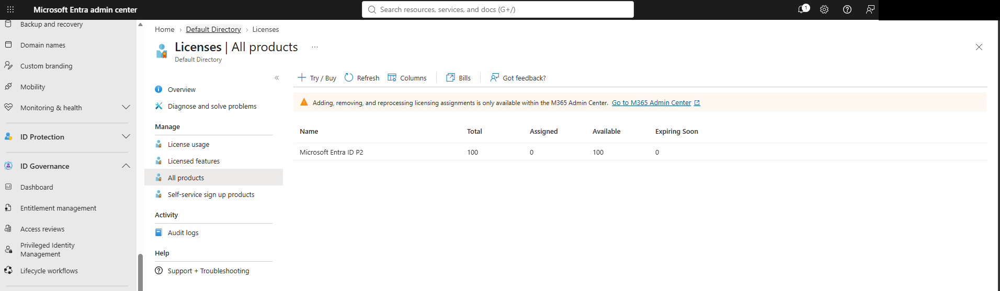
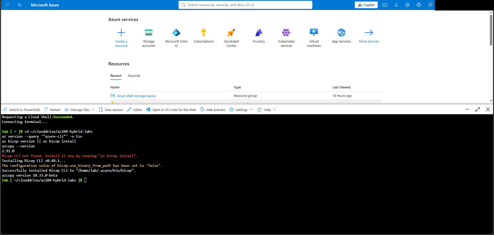
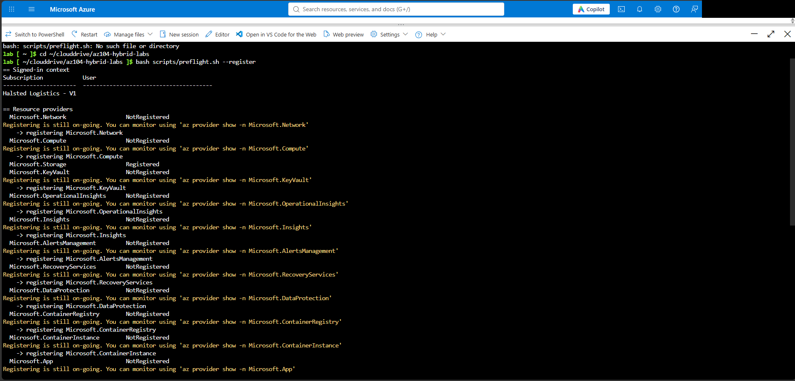
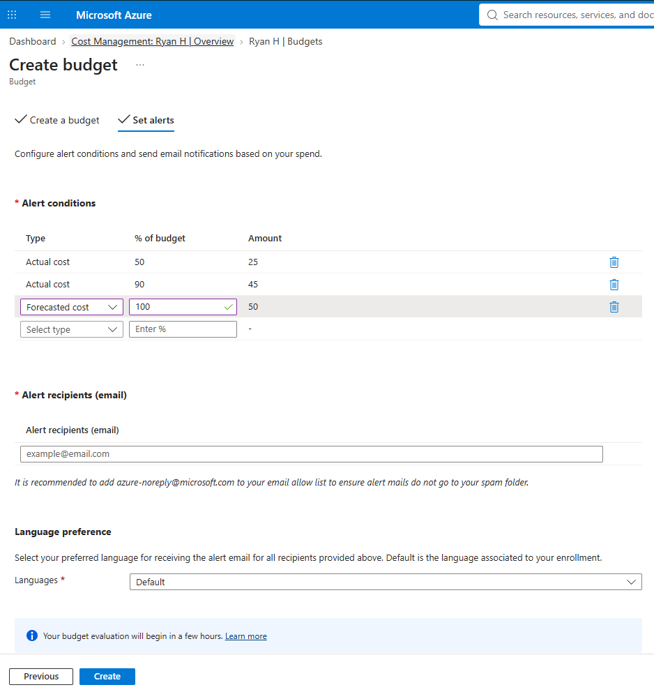
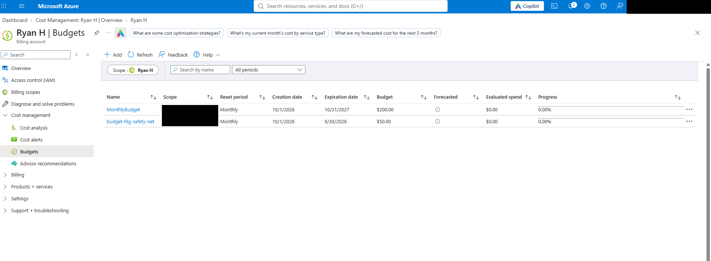

# Lab 00: Setup, Tooling and a Cost Safety Net

**Status:** Evidence 4 of 5 (00-01 pending) · **Date(s):** Oct 22–23, 2026 · **Time spent:** ~5 h · **Cost (Cost analysis):** $0.00

Lab guide: [labs/00-setup-and-safety-net.md](../labs/00-setup-and-safety-net.md) · Screenshots: `screenshots/lab-00/`

## What I built
- A cloud-only lab admin account (`labadmin`, "Bob Martinez") with MFA: **Global Administrator** in Entra ID and **Owner** on the subscription. I kept the account that created the subscription only as an emergency (break-glass) account.
- An Entra ID P2 trial (100 licenses), which unlocks PIM, Identity Protection and Conditional Access for the identity labs.
- A Cloud Shell for the lab admin with its **own** persistent Azure Files share, with this repo cloned into `~/clouddrive` and Azure CLI, Bicep and AzCopy checked.
- A preflight run that registers the resource providers and features the later labs need, and checks quotas and region availability.
- A $50 monthly safety-net budget with alerts at 50% actual, 90% actual and 100% forecast.

## Evidence
| Checkpoint | What it proves | Screenshot | Status |
|---|---|---|---|
| 00-01 | Subscription overview showing the offer type | `screenshots/lab-00/00-01-subscription-offer.png` | Pending |
| 00-02 | Licenses → All products showing the P2 trial |  | Done |
| 00-03 | Cloud Shell showing `az version` and `az bicep version` |  | Done |
| 00-04 | Preflight output |  | Done |
| 00-05 | The budget's alert conditions |  | Done |
| 00-05b | Budget created ($50, monthly) |  | Done |

## Commands I want to remember
```bash
# Who am I, and what can I do?
az account show --query user.name -o tsv
az role assignment list --assignee <upn> --all --query "[].{role:roleDefinitionName, scope:scope}" -o table

# Resource providers
az provider register -n Microsoft.CloudShell
az provider show -n Microsoft.CloudShell --query registrationState -o tsv

# Is my Cloud Shell storage mounted, and which share is it?
df -h | grep clouddrive
```

## What broke and how I fixed it
- **Symptom:** The lab admin (a Global Administrator) couldn't use Cloud Shell or see the subscription.
  **Cause:** Global Administrator is an Entra ID role. It grants no access to Azure resources.
  **Fix:** Assigned **Owner** on the subscription (Azure RBAC) from the subscription owner account.
- **Symptom:** After Owner was assigned, Cloud Shell storage creation still failed with `AuthorizationFailed`.
  **Cause:** With Entra ID P2 active, the portal created the Owner assignment as a PIM **Eligible** assignment, which does nothing until it's activated.
  **Fix:** Deleted it and reassigned Owner as **Active, Permanent**.
- **Symptom:** Cloud Shell warned "Failed to mount the Azure file share" and ran as an ephemeral session.
  **Cause:** The setup was pointed at a share the lab admin couldn't use.
  **Fix:** Reset the Cloud Shell user settings and let Cloud Shell create a share for the lab admin, separate from the other account's files.
- **Symptom:** The role check showed extra roles: Contributor on one storage account, and User Access Administrator at `/`.
  **Cause:** Contributor was left over from picking an existing storage account during setup. User Access Administrator at `/` came from Global Admin "elevated access".
  **Fix:** Removed the scoped Contributor and turned off *Access management for Azure resources*, leaving only Owner.
- **Avoided:** The new file share wizard defaulted to a **1 TiB provisioned SSD/NFS** share, billed whether used or not, with backup on. I cancelled it. Cloud Shell needs a small standard SMB share.

## Exam tips in my own words
- **Entra roles ≠ Azure roles.** Global Admin manages the directory. Owner/Contributor/Reader are granted on a scope (management group → subscription → resource group → resource).
- **PIM Eligible vs Active:** Eligible means you have to activate the role before you can use it. Active means it's always on.
- **Elevated access** puts a Global Admin in User Access Administrator at root `/`. Turn it off when you're done.
- **Owner ≈ Contributor + the right to assign roles.** A role assignment *condition* can stop Owner granting privileged roles.
- A resource provider has to be **registered** before you can deploy its resource types. Registering needs `*/register/action` (Contributor or Owner).
- **Budgets only alert. They never stop spending.**
- Cloud Shell keeps files only in its mounted Azure Files share (`clouddrive` plus a 5 GB `$HOME` image).

## Knowledge check score
- __ / 5 first try. Misses:

## Questions to follow up
- Re-run preflight until every provider and `EncryptionAtHost` show `Registered` (needed by Lab 08).
